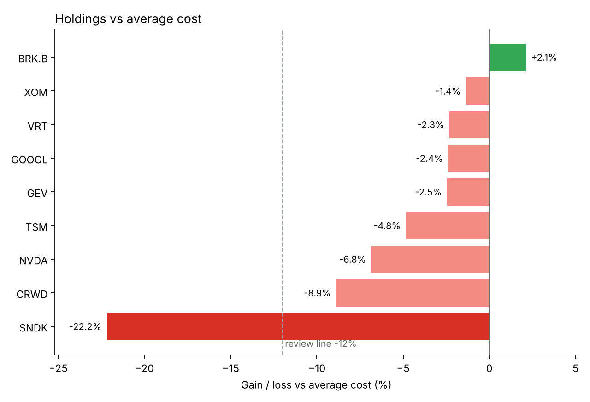
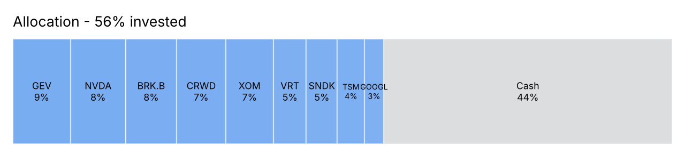

# WKU Campus Investment Challenge — portfolio & strategy toolkit

A small Python project built during a four-week simulated stock-picking contest at Wenzhou-Kean University (Oct 26 – Nov 20, 2026). Our three-person team traded a $100,000 Investopedia simulator account, limited to a list of 100 US stocks. This repo holds the tools we used to track the portfolio, set orders, check our own risk rules, and decide how aggressive to be.




*Snapshot after the U.S. close on Nov 2, 2026. The fifth rotation day (a TSM buy) locked in the top 5% bonus tier.*

## What it does

| Module | Purpose |
|---|---|
| `portfolio.py` | Replays the trade log with average-cost accounting, which is how the simulator reports cost. Then it values holdings, cash and weights at a price file, and attributes the total P&L to individual trades. |
| `rules.py` | Contest scoring (rotation bonus, off-list penalty), the limit-price rule and the risk checks. |
| `simulate.py` | Monte Carlo model comparing exposure, beta and concentration against a simulated field of competitors. |
| `report.py` | The two charts above. |
| `config.py` | Every contest and team rule as one set of constants. |

```bash
pip install -e .            # or: pip install -r requirements.txt
cd src
python -m wkuchallenge status                                  # holdings, score, rule warnings
python -m wkuchallenge limit TSM 2100 --prev-close 406.13      # limit price + share count
python -m wkuchallenge attribution                             # which trades made or lost money
python -m wkuchallenge simulate --start 96960 --days 14        # strategy comparison
python -m wkuchallenge charts                                  # regenerate reports/*.png
pytest                                                         # from the repo root
```

`status` output on the Nov 2 snapshot:

```
Cash 40,850.72 | Account 96,959.82 | Invested 58% (target 89%)
Rotation days 5: 2026-10-27, 2026-10-28, 2026-10-29, 2026-10-30, 2026-11-02
Rule checks:
  ! SNDK: -22.2% vs cost, past the 12% review line
```

The rebuilt account matches the simulator's figure to within $0.12 on every snapshot checked (see `tests/`).

## Contest rules encoded

- **Score** = account value + rotation bonus − off-list penalty.
- **Rotation bonus** is a share of *profit*: 2% for 1–2 rotation days, 3% for 3–4, and 5% for 5 or more. At most one rotation counts per trading day, and the first build day doesn't count.
- **Off-list penalty** is 5% of the amount opened in any ticker outside the list, capped at $10k.

## Team rules encoded

- **Limit price.** Reference = max(previous close, premarket) before the open, or the live price after it. The limit adds a +1% buffer for steady names and +2% for volatile ones (CRWD, RKLB, VRT, SNDK). This came from an early order that never filled because its limit sat below the open.
- **Position caps.** At most 16% in one stock and 28% in AI chips (NVDA + TSM). XOM (oil) and BRK.B (rates) act as hedges.
- **Brake.** A drawdown of 6% or more from the peak → sell the weakest name and cut to 70% invested.
- **Review lines.** A holding gets reviewed if it falls more than 7% in one day or sits more than 12% below cost.
- **No chasing.** Never buy a stock that is already up more than 8% on the day.

## Strategy model

With 14 trading days left and the account at $96,960, we ran 50,000 simulated contests against 123 competitors of mixed styles:

| Strategy | E[score] | Lose >8% | Bottom 20 | Top 10 | Top 3 |
|---|---:|---:|---:|---:|---:|
| Conservative, ~30% invested | 97,138 | 1.7% | 23.2% | 0.0% | 0.0% |
| Original plan, ~60% invested | 97,346 | 13.8% | 22.8% | 0.1% | 0.0% |
| Aggressive, ~89% in 5–6 names | 97,668 | 27.6% | 34.0% | 4.4% | 0.6% |
| All-in, 2–3 high-vol names | 98,039 | 36.1% | 41.1% | 19.2% | 8.1% |

The point the model made for us is that **in a ranked contest, playing safe almost guarantees a middle finish.** Moving up the table only happens by accepting a real chance of a bad result. The team chose a tolerance of about 15–20% for "losing badly", and this table is what that choice trades off against.

The model is deliberately simple. It has normal returns, no fat tails, no correlation between our picks and other teams', and no path-dependent rules. Read it as a comparison between strategies, not a forecast.

## Lessons so far

See [`docs/retrospective.md`](docs/retrospective.md).

## Data

- `data/trades.csv`: every fill from the simulator's trade history. The two Oct 30 fills are reconstructed from the portfolio page, accurate to a few cents.
- `data/prices_2026-10-30.csv`: closing prices from the portfolio page.
- `data/equity_log.csv`: account-value snapshots.
- `data/universe.csv`: the 100 allowed tickers by sector, taken from the rulebook appendix.

This is a student project using simulated money. Nothing here is investment advice.

---

### 中文简介

温州肯恩大学校园模拟选股赛（2026 年 10 月 26 日 – 11 月 20 日）的组队项目。这个工具包包括：用交易记录重建持仓和盈亏、按规则算限价单、检查风控纪律，以及用蒙特卡洛模型比较不同激进程度的胜率。数据来自 Investopedia 模拟盘，仅供学习，不构成投资建议。
